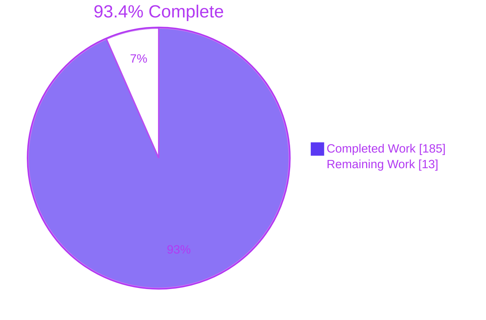
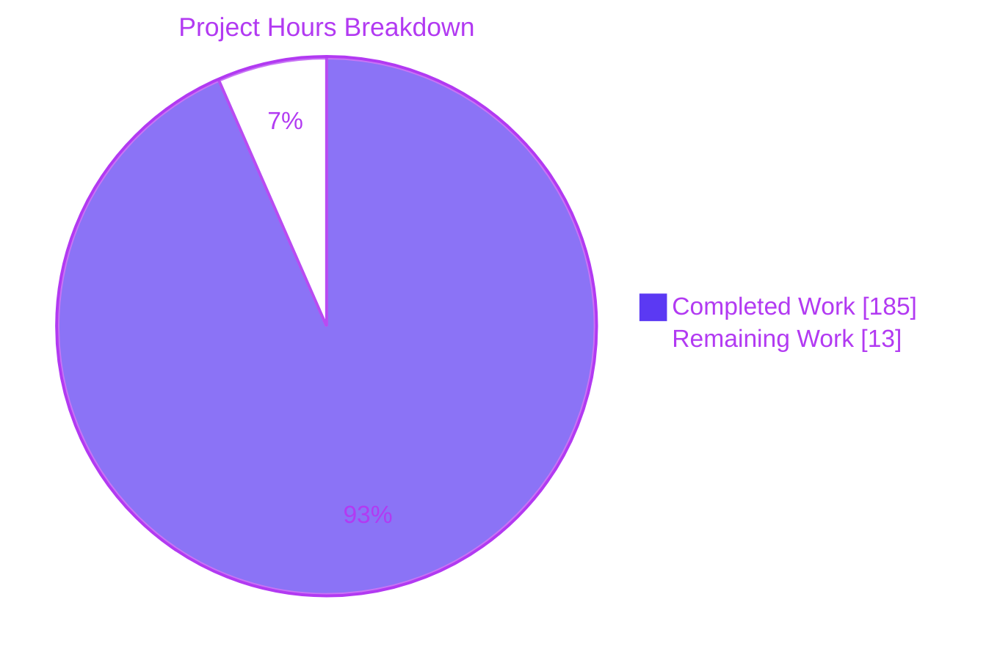
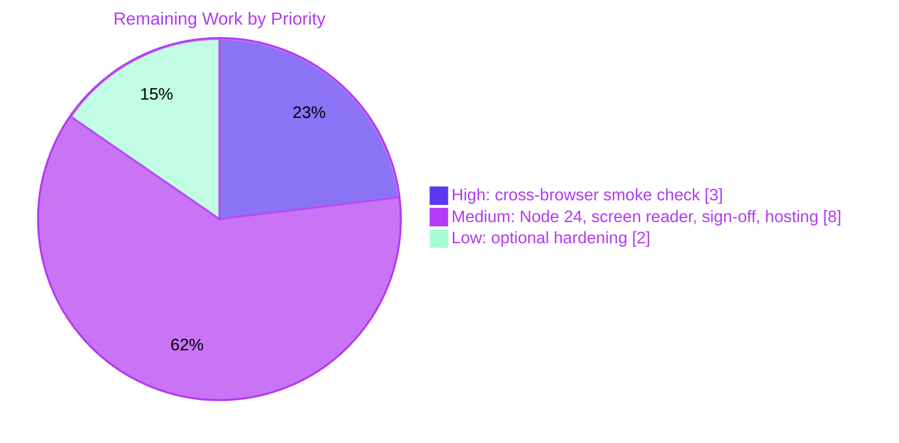

# 1. Executive Summary

## 1.1 Project Overview

Service Request Demo is a disposable, browser-only React 19, TypeScript 7 and Vite 8 single-page application. One person plays a simulated Requester or Reviewer to create, edit, submit, review and complete fictional service requests, each with an append-only audit history. It is built for evaluators and demo audiences. It has no backend, no accounts and no network traffic after load, and it persists to one `localStorage` key. The scope covers a domain workflow engine, a fault-tolerant storage adapter, a hand-written store, the App shell with ten component modules, one stylesheet, seven Vitest suites and the README: 37 files in all.

## 1.2 Completion Status



| Metric | Value |
|---|---|
| Total Hours | 198 |
| Completed Hours (AI + Manual) | 185 (185 AI + 0 manual) |
| Remaining Hours | 13 |
| Percent Complete | 93.4% |

185 hours completed out of 198 total hours = 93.4% complete. All implementation is delivered; the remaining hours are verification and release work.

## 1.3 Key Accomplishments

- ✅ Full R1–R16 workflow, proven by an exhaustive 84-combination permission grid
- ✅ All ten acceptance criteria (AC1–AC10) pass in the UI suites and in a live production-build run
- ✅ 1,006 of 1,006 tests pass; strict `tsc` and `vite build` succeed; `npm audit` finds 0 vulnerabilities
- ✅ Network isolation: 3 same-origin files load, then no further requests
- ✅ Storage failures degrade safely; unreadable data stays untouched until a reset or change
- ✅ A 381-test architecture guard enforces layering, banned APIs, URLs and the two-package runtime
- ✅ Accessible, responsive UI: labelled native controls, live announcements, visible focus, no overflow at 375 px
- ✅ README covering setup, the role switch, limitations and a network smoke check

## 1.4 Critical Unresolved Issues

1 of 33 requested items (R1–R16, AC1–AC10 and the 7 non-functional requirements) is open: **portability**, across browsers and Node runtimes. One more capability was built but never exercised against its real target: screen-reader announcements. None of these blocks the demo in Chrome.

| Issue | Impact | Owner | ETA |
|---|---|---|---|
| Portability, browsers: the final build is unconfirmed in branded Safari (checked on the WebKit engine only) and current Firefox (checked on an earlier build) | Safari storage eviction or rendering differences could reach evaluators unseen | Front-end developer with macOS | 3 h |
| Portability, runtimes: Node 24 and 26 are declared in `engines`, but only Node 22.23.4 was run | Install, test and build on those runtimes are unproven | Developer | 1 h |
| Screen-reader announcements verified structurally, never with VoiceOver or NVDA | Assistive-technology users may hear announcements differently | Accessibility tester | 3 h |

## 1.5 Access Issues

| System/Resource | Type of Access | Issue Description | Resolution Status | Owner |
|---|---|---|---|---|
| Safari on macOS | Test environment | The Linux build host cannot run branded Safari. Safari portability was checked on the WebKit 27.2 engine instead. | Open; needs a Mac | Front-end developer |

## 1.6 Recommended Next Steps

1. [High] Run the README "Manual smoke check" on the final build in branded Safari and current Firefox.
2. [Medium] Run `npm ci`, `npm test` and `npm run build` on Node 24 LTS.
3. [Medium] Do a live screen-reader pass with VoiceOver and NVDA.
4. [Medium] Sign off the settled divergences in Section 5.2.
5. [Medium] Publish `dist/` to a static host and repeat the smoke check there.

# 2. Project Hours Breakdown

## 2.1 Completed Work Detail

| Component | Hours | Description |
|---|---|---|
| Toolchain and configuration | 6 | `package.json` with exact pins and `engines`, lockfile v3, strict `tsconfig.json`, `vite.config.ts` with the Vitest block, `index.html`, `.gitignore` (AAP 0.4, 0.7.2) |
| Domain model and validation | 10 | Enumerations, `LIMITS`, sequential BigInt-safe IDs and code-point validation with exact messages (`src/domain/model.ts`, `validation.ts`; R11, R16) |
| Workflow engine and audit | 14 | Seven-row transition table, `applyCommand` ordering, refusal messages and append-only audit helpers (`src/domain/transitions.ts`, `audit.ts`; R1–R8) |
| Storage adapter and sample data | 12 | Versioned envelope, defensive parsing, load and save classification across every failure mode, three fixed samples (`src/storage/`; R13, R14) |
| Store, React binding and composition root | 8 | Frozen snapshots, save-then-publish, refusal lifecycle, `useSyncExternalStore` binding, injected clock and storage (`src/state/`, `src/main.tsx`) |
| App shell, routing and header controls | 12 | Hash router, banner, role switch, inline reset confirmation, storage notices, skip link and route focus (`src/App.tsx`, `src/components/`; R12, R14, R15) |
| Request views and forms | 26 | List view, create and edit form, details view with not-found, action panel with note forms and display formatting (R9, R10, R2–R7) |
| Styling, responsive layout and accessibility | 18 | One plain stylesheet: contained tables, focus, pressed and hover states, forced colours, RTL-safe borders, 44 px targets (`src/styles.css`) |
| Domain unit tests | 14 | 364 tests: validation boundaries and the exhaustive permission and execution grids (`src/domain/*.test.ts`) |
| Storage and store tests | 12 | 153 tests: load and save classification, envelope shape, persistence timing and recovery (`src/storage/`, `src/state/`) |
| UI flow and reload tests with harness | 20 | 108 tests over AC1–AC10, edge cases, accessibility and reload, plus shared helpers and setup (`src/test/`) |
| Architecture guard suite | 14 | 381 tests: a token-aware scanner over TS, TSX, CSS and HTML enforcing layering, API, URL, email and dependency bans (`src/test/architecture.test.ts`) |
| README documentation | 3 | Getting started, role switch, limitations, manual smoke check, about this demo (AAP 0.10.4) |
| Runtime, cross-browser, security and performance verification | 16 | Chrome production-build journeys, Firefox and WebKit portability runs, output-encoding, network, Lighthouse and volume checks |
| **Total** | **185** | |

## 2.2 Remaining Work Detail

| Category | Hours | Priority |
|---|---|---|
| [AAP portability] Run the README smoke check on the final build in branded Safari (macOS) and current Firefox, including the select arrow, forced colours, real-pointer hover and Safari private mode | 3 | High |
| [AAP portability] Run the install, test and build gate on Node 24 LTS (and Node 26 once it is LTS) | 1 | Medium |
| [Path-to-production] Live screen-reader pass (VoiceOver with Safari, NVDA with Firefox) over errors, status changes, notices and focus | 3 | Medium |
| [Path-to-production] Review and sign off the settled divergences and accepted behaviours in Section 5.2 | 2 | Medium |
| [Path-to-production] Publish `dist/` to a static host by hand (no pipeline, per AAP 0.8.2) and repeat the smoke check there | 2 | Medium |
| [Path-to-production] Decide optional hardening: disable Vite's modulepreload polyfill, cap stored ID length, mark bidi control characters | 2 | Low |
| **Total** | **13** | |

# 3. Test Results

All figures come from `CI=true npm test -- --maxWorkers=2` (Vitest 5.0.5) at the branch head: 7 of 7 files and 1,006 of 1,006 tests passed in 3.98 s. No coverage tool is configured, by AAP D11. Coverage is fixed by enumeration instead, and the Coverage column states what each suite enumerates.

| Area / Category | Framework | Tests | Passed | Failed | Coverage | What This Proves |
|---|---|---|---|---|---|---|
| Domain validation (`src/domain/validation.test.ts`) | Vitest, node environment | 99 | 99 | 0 | Every field and note rule, at both boundaries | Limits, trimming and exact messages hold, counted in code points, and frozen inputs are never mutated |
| Workflow transitions and audit (`src/domain/transitions.test.ts`) | Vitest, node environment | 265 | 265 | 0 | All 84 role × action × status combinations; 62 executable | Only the 7 permitted transitions succeed; the other 55 executable ones are refused with the history unchanged |
| Storage adapter (`src/storage/localStore.test.ts`) | Vitest, jsdom | 109 | 109 | 0 | All load and save outcomes, plus 60 envelope-shape cases | Stored data is parsed defensively, classified correctly, and never written by a load |
| Application store (`src/state/store.test.ts`) | Vitest, jsdom | 44 | 44 | 0 | Every startup mode and command outcome | One save per accepted command or reset, published only after saving; failed saves keep working in memory with a warning |
| UI flows (`src/test/flows.test.tsx`) | Vitest, React Testing Library, jsdom | 106 | 106 | 0 | AC1–AC4, AC6–AC8, AC10, plus 41 edge cases and 27 accessibility cases | User journeys, offered actions, inline errors, announcements and focus behave as specified |
| Reload persistence (`src/test/reload.test.tsx`) | Vitest, React Testing Library, jsdom | 2 | 2 | 0 | AC5 and the AC10 reload step | State and Urgent priority survive a full remount from stored data |
| Architecture guard (`src/test/architecture.test.ts`) | Vitest, `import.meta.glob` source scan | 381 | 381 | 0 | Every production, test and entry file | Layering, the network, storage and HTML-injection bans, the URL and email bans, and the two-package runtime set hold |
| **All suites** | Vitest 5.0.5 | **1,006** | **1,006** | **0** | 7 of 7 planned suites | The AC9 test gate passes |

The build gate also passed: `npm run build` ran strict `tsc --noEmit` with 0 diagnostics, then `vite build` with 34 modules and one JS and one CSS asset. `npm audit` finds 0 vulnerabilities.

**Not Covered**

- **Branded Safari and current Firefox on the final build.** No automated cross-browser suite exists, because AAP 0.8.2 excludes end-to-end tooling. Run the README manual smoke check in both before release.
- **Visual-only behaviour.** jsdom has no layout, so visibility, wrapping, focus rings, hover and forced-colours styling are covered by no test. They were checked by hand in Chrome only.
- **Live screen-reader output.** The suites assert ARIA roles, live regions and focus targets, not what VoiceOver or NVDA actually announce.
- **Real browser storage blocking.** The suites use storage doubles that throw on demand. Safari Intelligent Tracking Prevention eviction and private-mode storage are untested.
- **`src/main.tsx` wiring.** The composition root that binds `window.localStorage` and the browser clock is exercised only at runtime. The test harness builds the same tree with memory storage and a fixed clock.
- **Node 24 and 26.** All suites ran on Node 22.23.4 only.

# 4. Runtime Validation & UI Verification

These checks drove the production build (`vite preview`) and the dev server (`vite`) in Chrome 156, at 1280 px and 375 px widths.

- ✅ **Start-up.** The dev server and the preview server each return HTTP 200. On the dev server React Fast Refresh is active (`$RefreshReg$` is a function), with 0 errors or warnings from the app. `npm run dev` prints `http://localhost:5173/`.
- ✅ **First run.** The three sample requests show in memory and the storage key stays unwritten. The banner, the "Role (demo simulation, not authentication)" select set to Requester, and "Reset demo data" are present on every view.
- ✅ **Network isolation.** The production build loads exactly 3 same-origin files (page, JS, CSS) with no favicon request. It makes 0 requests through a full create, submit, review and reset workflow, and logs 0 console messages.
- ✅ **Requester journey.** Creating REQ-0004 gives a Draft with Normal priority and one Created audit row. Submit then gives Submitted, and a blank required field blocks it with inline messages.
- ✅ **Reviewer journey.** The role switch offers Start review. In Review then leads through Request more information, Supply information and Complete, ending on the terminal copy.
- ✅ **Persistence.** A reload keeps REQ-0004 In Review with all 3 audit rows, and the role returns to Requester. Storage holds `{ "version": 1 }` with 4 requests, and a confirmed reset restores the samples, so the next ID is REQ-0004.
- ✅ **Not-found views.** `#/settings` shows "Page not found." and an unknown ID shows "Request … was not found.", each with "Back to list". Hostile text in the hash renders as literal text.
- ✅ **Storage faults.** These were injected by script. Unreadable and wrong-version data stays byte-identical, with a reset offer and 0 startup writes. Unavailable or full storage keeps working in memory and shows the warning.
- ✅ **Layout and accessibility.** There is no page overflow at 375 px, and wide tables scroll inside their own containers. Keyboard-only journeys complete. Lighthouse scores 100 for performance (desktop and mobile) and 100 for accessibility, and the slowest interaction is 34.6 ms against a 200 ms budget.
- ⚠ **Portability.** Chrome 156 ran on the final build. Firefox 158 completed the full lifecycle on an earlier build, and Safari was represented by the WebKit 27.2 engine (45 of 45 checks).

**Never exercised at runtime:**
- branded Safari on macOS, including private browsing and storage eviction;
- the final stylesheet in Firefox;
- VoiceOver or NVDA output;
- storage blocked by real browser settings rather than by script;
- a hover-capable pointer, because headless Chrome matches `hover: none`;
- Node 24 and 26.

Authentication is not applicable: the product has no login by design.

# 5. Compliance & Quality Review

## 5.1 Compliance Matrix

| # | AAP Deliverable | Benchmark | Status | Progress | Evidence |
|---|---|---|---|---|---|
| 1 | Workflow and domain rules (R1–R8, R11, R16; AAP 0.5.2–0.5.3) | Correct and exhaustively tested | ✅ Pass | 100% | `src/domain/transitions.ts`; 364 domain tests |
| 2 | Persistence and storage modes (R13, R14; 0.5.2.5, 0.6.2) | Reliability: no crash; unreadable data preserved and flagged to the user | ✅ Pass | 100% | `src/storage/localStore.ts`; 153 storage and store tests; fault injection at runtime |
| 3 | Views, fixed copy and the offered-actions matrix (R9, R10, R12, R15; 0.5.5) | Copy verbatim; actions per role and status | ✅ Pass | 100% | `src/components/`; flows suite; browser run |
| 4 | Acceptance criteria AC1–AC10 (0.10.3) | Automated and runtime proof | ✅ Pass | 100% | `flows.test.tsx`, `reload.test.tsx`; AC9 gates run first-hand |
| 5 | Architecture and layering (0.3.2) | Enforced by a test, not by convention | ✅ Pass | 100% | `architecture.test.ts`, 381 tests |
| 6 | Network isolation and security NFRs (0.3.3, 0.3.2.5, 0.8.3) | 0 post-load requests, escaped output, 0 known vulnerabilities | ✅ Pass | 100% | 3 requests on load; `npm audit` 0 |
| 7 | Dependencies and toolchain (0.4) | Exact pins, two runtime packages, enforced `engines` | ✅ Pass | 100% | `package.json`, lockfile v3 |
| 8 | Code quality and conventions (0.13.1–0.13.2) | Strict TypeScript, no console output, one-line TSDoc on exports, no placeholders | ✅ Pass | 100% | `tsc --noEmit` 0 diagnostics; no TODO or FIXME markers |
| 9 | Accessibility NFR (0.1.1.2) | Native controls, `aria-describedby`/`aria-invalid`, alert and status roles | ✅ Pass | 100% | Lighthouse accessibility 100; live screen-reader pass pending |
| 10 | Portability NFR (0.1.1.2) | Current Chrome, Firefox and Safari; Node LTS | ⚠ Partial | 70% | Chrome final build; Firefox on an earlier build; WebKit engine for Safari |
| 11 | Repository structure and scope (0.7, 0.8.2, 0.9.1) | Exactly 37 files; no excluded tooling | ✅ Pass | 100% | `git ls-files` = 37; README modified rather than created |
| 12 | Documentation (0.10.4) | All 11 README rows present and accurate | ✅ Pass | 100% | `README.md`; smoke-check step 3 reworded |

## 5.2 AAP & Rule Divergences and Gaps

No user rules exist for this project (AAP 0.11), so every divergence below is from the AAP. None was requested by a human. D1 is open; D2–D8 are settled design decisions that await the owner's sign-off.

| # | What the AAP/Rule Required | What Was Delivered Instead | Why It Diverged | Impact | Remediation |
|---|---|---|---|---|---|
| D1 | Current Chrome, Firefox and Safari; Node LTS (0.1.1.2) | Final build verified in Chrome; Firefox on an earlier build; Safari via the WebKit engine; Node 22 only | The Linux build host has no Safari or Node 24 | Safari storage policy and rendering unproven | Smoke check in Safari and Firefox; gate on Node 24 (4 h) |
| D2 | `ActionPanel({ request, role, onEdit, onSubmitErrors })` (0.5.1.4) | An added required `onTransition` callback | Keeps keyboard focus after the keyed remount | Wider interface, purely additive | Accept, or remove and accept focus loss |
| D3 | No internationalisation (0.8.2) | `dir="auto"` on text inputs and rendered user text | Right-to-left text rendered mis-ordered | Sets direction only; no translation | Accept as direction-only |
| D4 | Every file is a CREATE in an empty repository (0.9.1) | `README.md` is a modification | The initial commit already held a placeholder README | None; content fully replaced | None needed |
| D5 | Smoke check: "switch role" (0.10.3) | "switching the role as each action requires" | One switch cannot carry the full sequence | Clarifies; intent unchanged | Accept |
| D6 | Vitest options as listed (0.7.2) | Adds `css: { include: [/[?&]raw(?:&|$)/] }` | Without it the URL ban scans an empty stylesheet | Test-only; bundle unchanged | Accept |
| D7 | Interfaces and behaviour as specified (0.5.1, 0.5.5) | Additive exports, escapes, focus handling and double-click guards | Accessibility and untrusted-data robustness | More code to maintain; all tested | Accept or trim |
| D8 | Behaviour as the AAP words it | Known edge behaviours kept as worded | Changing them would depart from the AAP | Minor single-user edge cases | Sign off, or harden (Section 2.2) |

**D1: Portability.** AAP 0.1.1.2 targets current stable Chrome, Firefox and Safari, plus local development on Node.js LTS. Chrome 156 exercised the final build end to end. Firefox 158 completed the full lifecycle headless on an earlier build, before the last stylesheet changes. Safari was represented by the WebKit 27.2 engine, which passed 45 of 45 checks, because the Linux build host cannot run branded Safari. Node 22.23.4 was the only runtime available. Safari-only behaviour therefore remains unobserved: Intelligent Tracking Prevention eviction, private-mode storage and `system-ui` fonts. To close it, run the README smoke check on a Mac and in current Firefox, and run the gate on Node 24.

**D2: Additive `onTransition` prop.** AAP 0.5.1.4 gives `ActionPanel` four props. `src/components/ActionPanel.tsx:24` adds a fifth, `onTransition: () => void`, which is called after each successful transition (lines 138–151). AAP 0.5.5.3 keys the panel by role and status, so a successful action unmounts the very button that had focus. Without this signal, focus would fall to the page body. `DetailsView` uses the callback to focus the heading, and flows tests in "Accessibility announcements and focus" assert the result. No specified behaviour changes. Decide whether to keep the wider interface or accept the focus loss.

**D3: `dir="auto"` despite the internationalisation exclusion.** AAP 0.8.2 places internationalisation out of scope. The components carry 11 `dir="auto"` attributes: on the RequestForm name and description fields, the note textarea, rendered values, Note cells and the unknown-ID chip (for example `src/components/DetailsView.tsx:89`). Right-to-left text in user input otherwise rendered with reversed punctuation and the wrong alignment. The attribute sets only the base text direction. Nothing is translated, localised or switched, so the spirit of the exclusion holds, and the "User text direction" flows tests cover it. Confirm that this reading of the exclusion is acceptable.

**D4: README modified, not created.** AAP 0.9.1 states that every file is a CREATE, because "the repository starts empty". It did not. Commit `2bd0f00` on `origin/main` already contained a two-line placeholder `README.md`, so the branch shows that file as modified (+94/−2) while the other 36 paths are additions. The placeholder text is fully replaced by the content AAP 0.10.4 specifies, so the delivered file is what a CREATE would have produced. No action is needed beyond noting that the diff shows a modification.

**D5: Smoke-check wording.** AAP 0.10.3 phrases the manual smoke check with a single "switch role" step. `README.md` step 3 reads "switching the role as each action requires" instead. The listed sequence runs create, edit, submit, start review, request information, supply information, complete and reset. Supply information needs the Requester and Complete needs the Reviewer, so one switch cannot carry it as written. The check's purpose is unchanged: a full lifecycle plus reset with an empty network log. A run against the production build confirms that it holds. Accept the clarified wording.

**D6: Extra Vitest option.** AAP 0.7.2 lists the Vitest options as jsdom environment, setup file, include pattern and globals off. `vite.config.ts:15` adds `css: { include: [/[?&]raw(?:&|$)/] }`. Vitest returns an empty string for every CSS request it is not told to process, `?raw` requests included. Without the option, `architecture.test.ts` would scan a blank `src/styles.css`, and the AAP 0.8.3 ban on external URLs and font loading would pass on nothing. Only `?raw` CSS requests match, so the production build and ordinary test CSS are unaffected. Accept it as test infrastructure.

**D7: Behaviour the AAP does not name.** AAP 0.5.1 and 0.5.5 are silent on several additions. `src/components/format.ts` exports `timestampClassName` so timestamps with years outside 0–9999 wrap inside their cells. The unknown-ID chip shows invisible code points as ⟨U+XXXX⟩ (`DetailsView.tsx:83–89`). `App.tsx` adds a skip-link button and moves focus to main on route changes. `ResetControl` returns focus to its trigger, detail rows are `aria-live`, `RequestForm` and `ActionPanel` ignore double-clicks, the architecture suite runs extra checks, and IDs use BigInt arithmetic. They serve WCAG 2.4.3 focus order and the AAP 0.3.2.5 rule that stored data is untrusted. Flows or domain tests cover each. Decide whether to keep them all.

**D8: Edge behaviours kept as the AAP words them.** A blank requester name or description on a non-Draft stored request loads as valid, because AAP 0.3.2.3 names only a blank type. After a startup with unavailable storage, the first successful save overwrites stored data the app never read, as AAP 0.6.2 specifies ("When a retry succeeds, it writes the in-memory list"). Stored IDs have no length cap. Focus falls to the page body after "New request", after the create form's Cancel, and after confirming reset in the load-issue notice. Requester submit errors stay visible after a switch to Reviewer (AAP 0.5.5.4). Stored data is not tamper-evident (AAP 0.3.2.5). Sign these off, or take on the optional hardening in Section 2.2.

# 6. Risk Assessment

| Risk | Category | Severity | Probability | Mitigation | Status |
|---|---|---|---|---|---|
| Safari Intelligent Tracking Prevention or private-mode storage drops an evaluator's demo data | Integration | Medium | Medium | The README Limitations section states that data is browser-local and may be cleared; run the Safari smoke check (Section 2.2) | Open |
| The final stylesheet renders differently in Firefox or Safari: the native-look select arrow, forced colours, `:has()` focus ring, `display: block` tables | Technical | Medium | Low | Cross-browser smoke check; each rule has a plain fallback | Open |
| Stored data is editable through DevTools and the role switch protects nothing | Security | Low | High | By design (AAP 0.3.2.5): data is parsed defensively and rendered as escaped text; the banner and README say so | Accepted |
| Bidi-override or invisible characters in stored text visually mislead a reader | Security | Low | Low | `dir="auto"` with isolation contains the effect to one field; the unknown-ID chip shows invisible code points as ⟨U+XXXX⟩ | Mitigated |
| Vite's modulepreload polyfill leaves a dormant `fetch(` in the bundle | Security | Low | Low | It runs only for `<link rel="modulepreload">`, which the page never contains; set `build.modulePreload: { polyfill: false }` to remove it | Open (optional) |
| Unbounded data volume: no ID length cap; 15,000 audit entries take about 1.06 s to render | Technical | Low | Low | No volume target exists (AAP 0.1.1.2); cap ID length on load if wanted | Accepted |
| A public static host adds scripts or headers, or serves the build from a sub-path; no CSP exists (AAP 0.8.2) | Operational | Low | Medium | Serve `dist/` from the host root unmodified and repeat the 3-request smoke check there | Open |
| Tooling traps: Vite moves port silently without `--strictPort`; killing only the `npm run dev` pid orphans Vite; `NODE_ENV=development` builds a development React bundle | Operational | Low | Medium | Documented in Section 9 troubleshooting | Documented |

# 7. Visual Project Status

**Project hours: 185 completed, 13 remaining, 198 total (93.4% complete)**



**Remaining hours by priority (13 hours)**



| Remaining category (Section 2.2) | Hours | Priority |
|---|---|---|
| Safari and Firefox smoke check on the final build | 3 | High |
| Node 24 LTS gate | 1 | Medium |
| Live screen-reader pass | 3 | Medium |
| Divergence and accepted-behaviour sign-off | 2 | Medium |
| Manual static hosting and hosted smoke check | 2 | Medium |
| Optional hardening decisions | 2 | Low |
| **Total** | **13** | |

# 8. Summary & Recommendations

The project is 93.4% complete: 185 of 198 hours. Every implementation deliverable in the AAP is in the repository. That covers the 37 planned files, all sixteen functional requirements, all ten acceptance criteria and six of the seven non-functional requirements. The domain engine, the storage adapter, the store, the App shell and the ten component modules are verified at three levels. First, 1,006 automated tests pass, including an exhaustive permission grid and a 381-test architecture guard. Second, the strict build and the dependency audit pass. Third, the production build was driven in a browser through the full Requester and Reviewer lifecycle, reload, reset and every storage failure mode, with exactly three same-origin requests on load and none afterwards.

The one open requirement is portability. The final build has run end to end in Chrome only. Firefox completed the lifecycle on an earlier build, and Safari was represented by its WebKit engine because no Mac was available. The other remaining work is release hygiene rather than construction: run the gate on Node 24, do a live screen-reader pass, sign off the eight documented divergences, and publish the static build. All 13 remaining hours appear in Section 2.2. None of them needs a code change unless the owner chooses the optional hardening.

The critical path to release is short. First, run the README "Manual smoke check" on a Mac in branded Safari, then in current Firefox. Watch for storage behaviour in private mode and the stylesheet items listed in Section 6. Next, run `npm ci`, `npm test` and `npm run build` on Node 24. Then publish `dist/` unmodified to the chosen static host and repeat the three-request network check on the hosted URL. The screen-reader pass and the divergence sign-off can run in parallel with these steps.

| Success metric | Target | Observed |
|---|---|---|
| Automated tests | All pass | 1,006 / 1,006 |
| Strict type check and build | Exit 0 | Exit 0, 34 modules, 1 JS + 1 CSS |
| Known vulnerabilities | 0 | 0 |
| Requests after load | 0 | 0 (3 on load: page, JS, CSS) |
| Console messages, production build | 0 | 0 |
| Browsers verified on the final build | Chrome, Firefox, Safari | Chrome (Firefox on an earlier build; WebKit engine for Safari) |

**Production readiness:** ready as the disposable public demo the AAP describes (AAP 0.1.3), once the Safari and Firefox smoke check passes. It is not a production system and does not claim to be: it has no authentication, the role switch protects nothing, and data lives only in the evaluator's browser. The banner and README state all of this plainly.

# 9. Development Guide

## 9.1 System Prerequisites

- **Node.js** inside `^22.22.2 || ^24.15.0 || >=26.0.0`. Verified on 22.23.4. Node 20 is refused (`EBADENGINE` under `--engine-strict`).
- **npm** 10 or later. Verified on 11.21.0. npm is the only supported package manager.
- **A current browser:** Chrome, Firefox or Safari.
- **Not needed:** environment variables, secrets, a database, Docker or network services. Any OS that runs Node works.

## 9.2 Environment Setup

Every command runs from the repository root, the directory that holds `package.json`.

```bash
cd <repository-root>
node -v                        # expect v22.22.2+ or v24.15.0+
npm -v                         # expect 10+
```

No `.env` file is read. The only state is the browser's `localStorage` key `service-request-demo.v1`, and it is separate per origin, so each port has its own data.

## 9.3 Dependency Installation

```bash
CI=true npm ci --no-audit --no-fund
```

Expected output: `added 94 packages in 1s`. `npm ci` installs the exact pins from `package-lock.json`. The README's `npm install` also works and leaves the lockfile unchanged. Never add a runtime dependency: `src/test/architecture.test.ts` asserts that `dependencies` are exactly `react` and `react-dom`.

## 9.4 Test, Type-check and Build

```bash
CI=true npm test -- --maxWorkers=2       # vitest run: single pass, never watches
npm run build                            # tsc --noEmit (strict), then vite build into dist/
npm audit                                # expect: found 0 vulnerabilities
```

Expected test output: `Test Files 7 passed (7)` and `Tests 1006 passed (1006)`, in about 4 s.

Expected build output: `✓ 34 modules transformed`, `dist/index.html` 0.76 kB, one `dist/assets/index-*.css` of about 8.6 kB, and one `dist/assets/index-*.js` of about 248 kB (76 kB gzip).

To run one area only:

```bash
npx tsc --noEmit && CI=true npx vitest run src/domain --maxWorkers=2    # 2 files, 364 tests
```

## 9.5 Application Startup

Dev server, with hot reload:

```bash
npm run dev                                   # prints http://localhost:5173/
# or on a chosen port, refusing to move if it is busy:
npx vite --port 15100 --strictPort
```

Production preview, which the network smoke check requires:

```bash
npm run build
npm run preview                               # serves dist/ on http://localhost:4173/
# or:
npx vite preview --port 15101 --strictPort
```

When running either server in the background, record its pid:

```bash
nohup npx vite preview --port 15101 --strictPort > preview.log 2>&1 & echo $!
```

## 9.6 Verification Steps

```bash
curl -s -o /dev/null -w '%{http_code}\n' http://localhost:15101/    # expect 200
curl -s http://localhost:15101/ | grep '<title>'                    # <title>Service Request Demo</title>
```

In the browser at `/#/`, confirm the following:
- the banner reads "Demo only. Fictional data. Role switch is a simulation, not authentication. Data is stored in this browser only.";
- the "Role (demo simulation, not authentication)" select shows Requester;
- "Reset demo data" is present;
- the "Service requests" table lists REQ-0001, REQ-0002 and REQ-0003.

On the preview server, DevTools → Network should show exactly three requests on load (page, JS, CSS) and none afterwards. The console should show no messages.

## 9.7 Example Usage

1. As Requester, click **New request**. Enter a name, choose a request type, enter a description, then click **Create draft**. The app opens REQ-0004 as a Draft with Normal priority and one Created audit row.
2. Click **Edit**, change Priority to Urgent and save. The audit note reads "Priority: Normal to Urgent".
3. Click **Submit**. Switch the role to Reviewer, click **Start review**, then **Request more information** with a reason.
4. Switch to Requester and click **Supply information**. Switch to Reviewer and click **Complete**. The app shows "This request is completed. No further actions are available."
5. Reload. The state persists and the role returns to Requester.
6. Click **Reset demo data**, then **Confirm reset**. The three samples return, and the next new ID is REQ-0004.

## 9.8 Stopping Servers

The pid from `echo $!` belongs to the `npx` wrapper only. Stop it and the `node` process that owns the port:

```bash
kill <wrapper-pid>
ss -ltnp | grep ':15101'          # or: fuser 15101/tcp ; then kill the node pid it shows
```

Never kill by process name.

## 9.9 Troubleshooting

| Symptom | Cause | Resolution |
|---|---|---|
| `Port 15101 is already in use` and exit 1 | Another server holds the port and `--strictPort` refuses to move | Pick another port, or stop the owner (Section 9.8) |
| The dev server starts on 5174 instead of 5173 | 5173 was busy and Vite moved without warning | Add `--strictPort` |
| `EBADENGINE … Required: {"node":"^22.22.2 \|\| ^24.15.0 \|\| >=26.0.0"}` | Node 20 or another unsupported version | Install Node 22 or 24 LTS |
| `npm ci` fails with `EUSAGE … does not satisfy` or `Missing: … from lock file` | `package.json` and `package-lock.json` disagree | Restore both files from git; do not hand-edit the pins |
| `npm run build` fails with TS6133 | An unused import or local (`noUnusedLocals`, `noUnusedParameters`) | Remove it; strict `tsc` gates the build |
| The architecture suite fails after adding a file under `src/` | Every non-test file must belong to a known layer; new runtime dependencies are banned | Place the file in `domain`, `storage`, `state` or `components`, or delete stray scratch files |
| `npm run build` output is about 463 kB | `NODE_ENV=development` is exported in the shell | `unset NODE_ENV` and rebuild |
| The network smoke check shows a WebSocket | The check is running on the dev server, which keeps Vite's HMR socket open | Use `npm run build` and `npm run preview` |
| "Stored demo data could not be read, so it has been left unchanged." (or "…uses an unsupported version…") | The `localStorage` value is corrupt or has another version | Click "Reset to sample data", or clear site data |
| "Browser storage is unavailable or full. Changes will not persist after this session." | Storage is blocked or full | Allow site storage, or free quota; the app keeps working in memory |

# 10. Appendices

## A. Command Reference

| Command | Purpose |
|---|---|
| `CI=true npm ci --no-audit --no-fund` | Install the exact pinned dependencies (94 packages) |
| `npm install` | README install step; resolves from the committed lockfile without changing it |
| `CI=true npm test -- --maxWorkers=2` | Run all 7 Vitest suites once (`vitest run`) |
| `CI=true npx vitest run <path> --maxWorkers=2` | Run one suite or directory |
| `npx tsc --noEmit` | Strict type check of `src/` and `vite.config.ts` |
| `npm run build` | `tsc --noEmit && vite build` into `dist/` |
| `npm run dev` / `npx vite --port <p> --strictPort` | Dev server with React Fast Refresh |
| `npm run preview` / `npx vite preview --port <p> --strictPort` | Serve the built `dist/` |
| `npm audit` | Dependency advisory check (0 vulnerabilities) |

## B. Port Reference

| Port | Service | Notes |
|---|---|---|
| 5173 | `npm run dev` (Vite default) | Vite's HMR WebSocket shares it; add `--strictPort` to refuse a silent move |
| 4173 | `npm run preview` (Vite default) | Use it for the network smoke check |
| Any free port | `--port <p> --strictPort` | Each origin has its own `localStorage` |

## C. Key File Locations

| Path | Role |
|---|---|
| `src/domain/transitions.ts` | Seven-row transition table, `applyCommand`, `availableActions`, `isTerminal` |
| `src/domain/model.ts`, `validation.ts`, `audit.ts` | Types, limits, ID formatting, validation messages, audit helpers |
| `src/storage/localStore.ts`, `sampleData.ts` | Key `service-request-demo.v1`, envelope parsing, load and save classification, three samples |
| `src/state/store.ts`, `StoreContext.tsx` | Application store and its `useSyncExternalStore` binding |
| `src/main.tsx` | Composition root: `window.localStorage` getter, browser clock, `StrictMode` render |
| `src/App.tsx`, `src/components/` | Shell, hash routing, banner, role switch, reset, notices, list, form, details, action panel |
| `src/styles.css` | The single stylesheet (system font stack, no external resources) |
| `src/test/` | `setup.ts`, `helpers.tsx`, `flows.test.tsx`, `reload.test.tsx`, `architecture.test.ts` |
| `vite.config.ts`, `tsconfig.json`, `index.html`, `package.json` | Build, compiler, entry page and manifest |
| `README.md` | Run instructions, role switch, limitations, manual smoke check |

## D. Technology Versions

| Technology | Version |
|---|---|
| React / React DOM | 19.3.1 |
| TypeScript | 7.0.2 |
| Vite | 8.3.5 |
| @vitejs/plugin-react | 6.1.2 |
| Vitest | 5.0.5 |
| jsdom | 30.1.3 |
| @testing-library/react / @testing-library/dom | 16.3.3 / 10.4.2 |
| @types/react / @types/react-dom | 19.3.0 |
| Node.js (`engines`) | `^22.22.2 \|\| ^24.15.0 \|\| >=26.0.0` (verified on 22.23.4) |
| npm | 10+ (verified on 11.21.0); lockfileVersion 3 |

## E. Environment Variable Reference

None. The application reads no environment variables, secrets or configuration files. Avoid exporting `NODE_ENV=development` before `npm run build`, because it produces a development React bundle.

## F. Developer Tools Guide

- **Type check:** strict `tsc` is the only static check. No linter, formatter or coverage tool exists, by AAP D11, so follow the existing style by hand: 2-space indentation, single quotes, semicolons and trailing commas.
- **Architecture guard:** `src/test/architecture.test.ts` scans every source file. It fails on a layering violation, on network, storage or HTML-injection APIs, on absolute URLs, on email-shaped text and on any runtime dependency beyond React.
- **Test harness:** `src/test/helpers.tsx` provides `createMemoryStorage`, the `unavailableStorageGetter` double, `createFixedClock`, `renderApp` and `deepFreeze`. `src/test/setup.ts` clears storage and the URL hash between tests.
- **Inspecting data:** in DevTools, run `JSON.parse(localStorage.getItem('service-request-demo.v1'))`. Removing the key restores first-run behaviour.

## G. Glossary

| Term | Meaning |
|---|---|
| Requester / Reviewer | The two simulated roles; switching between them is a demo aid, not authentication |
| Draft → Submitted → In Review ⇄ Waiting for Information → Completed | Request lifecycle; Completed is terminal |
| Audit history | Append-only list of entries (timestamp, role, action, from, to, note) per request |
| Envelope | The stored `{ "version": 1, "requests": [...] }` value |
| Load issue | Stored data that is unreadable or uses an unsupported version; left untouched until reset or a change |
| Refusal alert | Defensive message shown when an action that is no longer permitted is attempted |
| AC1–AC10, R1–R16, D1–D15 | AAP acceptance criteria, functional requirements and design decisions |
